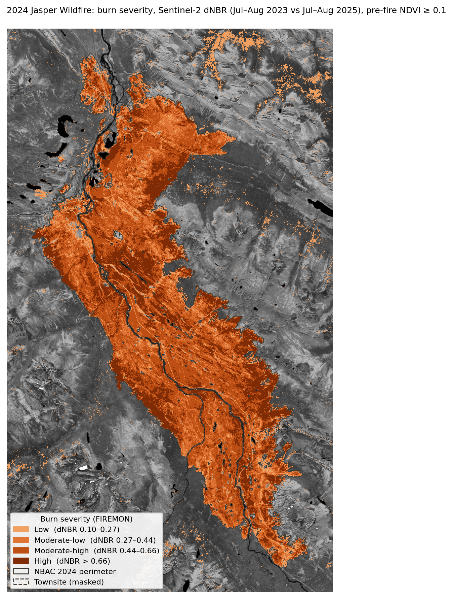
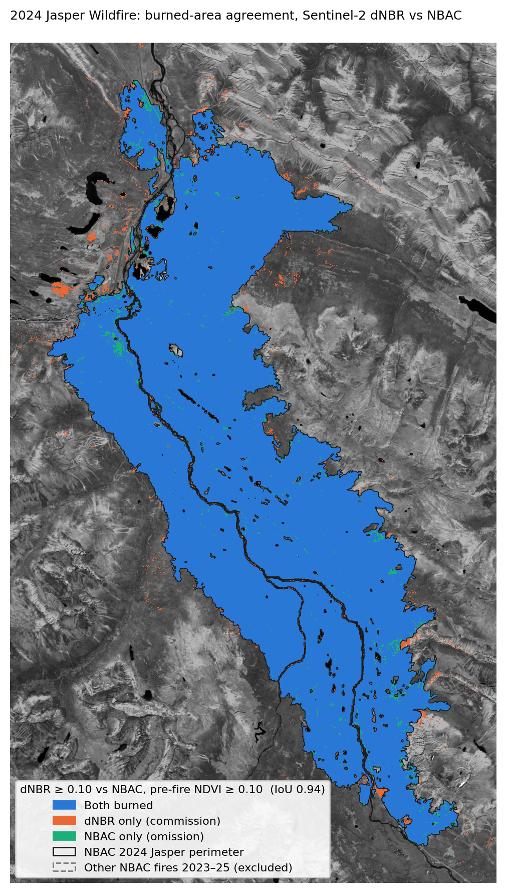
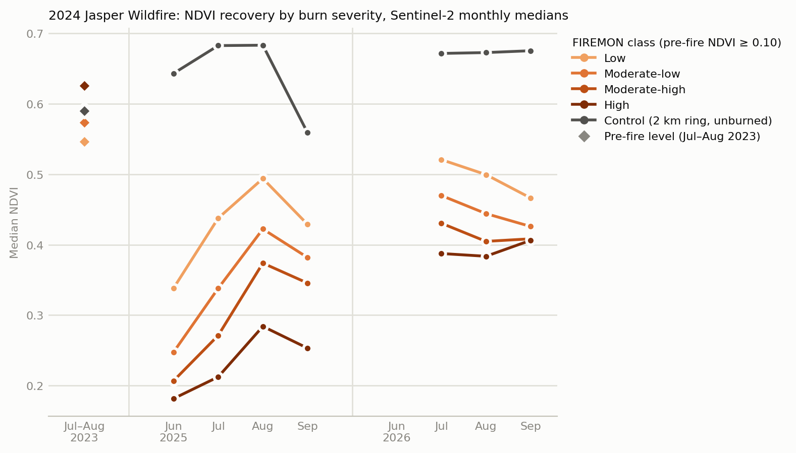
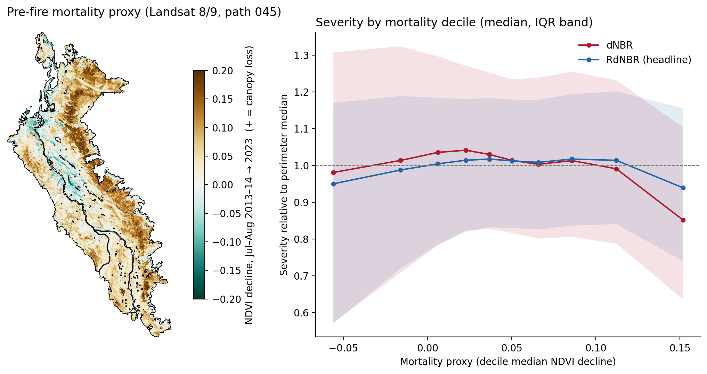

# jasper-burn-severity

Burn severity, validation, early recovery, and a test of the beetle-kill hypothesis for the **2024 Jasper Wildfire** (Jasper National Park, Alberta), from Sentinel-2 L2A and Landsat 8/9 imagery.

Companion repo: [fire-weather-windows](https://github.com/MegaDeadCowboy/fire-weather-windows) (before the fire / after the fire).



## Key results

| Question | Result |
|---|---|
| **Severity** (FIREMON dNBR classes, inside the NBAC perimeter) | 31,456 ha classified: Unburned 2.8%, Low 8.0%, Moderate-low 21.2%, **Moderate-high 43.1%**, High 24.9% |
| **Validation** (dNBR ≥ 0.10 vs NBAC perimeter, perimeter + 2 km) | IoU **0.941**, precision 0.968, recall 0.972, F1 0.970; burned area within **+0.39%** of NBAC |
| **Recovery** (Jul–Aug NDVI, 2026, control-adjusted % of pre-fire) | Low 82%, Moderate-low 70%, Moderate-high 62%, High 54% |
| **Beetle kill → severity?** (1 km blocks, n = 327) | **No association**: RdNBR Spearman ρ = +0.008 (p = 0.88); dNBR ρ = −0.103 (p = 0.062) |

## Data

| Data | Source | Use |
|---|---|---|
| Sentinel-2 L2A | Microsoft Planetary Computer STAC (`sentinel-2-l2a`), tile 11UMU | Pre-fire (Jul–Aug 2023, 26 scenes) and post-fire (Jul–Aug 2025, 16 scenes) median composites; monthly 2025–2026 NDVI |
| Landsat 8/9 Collection 2 L2, Tier 1 | Planetary Computer (`landsat-c2-l2`), path 045 | Pre-fire mortality proxy: NDVI decline, Jul–Aug 2013–14 → 2023 |
| NBAC 2024 perimeter (NFIREID 451, 31,645 ha) | Natural Resources Canada, CWFIS Datamart | Validation reference |
| Population centre "Jasper" (2021) | Statistics Canada boundary file `lpc_000b21a_e` | Townsite mask |

## Methods

- **Compositing:** SCL cloud mask keeping classes {2, 4, 5, 6, 7} (class 2 kept so fresh char isn't masked), processing-baseline ≥ 04.00 offset removed, all bands on one 20 m UTM 11N grid, per-pixel median.
- **Indices:** NBR = (B8A − B12)/(B8A + B12); NDVI = (B8 − B4)/(B8 + B4); dNBR = NBR_pre − NBR_post. The 2 km unburned ring has median dNBR 0.005, so no offset is applied and USGS FIREMON thresholds are used as-is.
- **Masks:** pre-fire NDVI ≥ 0.10 removes water, rock and ice (153 ha inside the perimeter). The Jasper townsite (Statistics Canada 2021 population centre) is masked from all forest statistics; only 12.5 ha of it falls inside the NBAC perimeter.
- **Validation:** NBAC perimeter rasterized to the 20 m grid (unburned islands kept as holes); confusion matrix over the perimeter plus a 2 km buffer.
- **Recovery:** monthly Jun–Sep NDVI composites for 2025 and 2026 (a month is dropped if > 5% of perimeter pixels have no clear observation; June 2026 was dropped). Each severity class is compared with an unburned 2 km control ring, because the control itself is ~14% greener in 2025–26 than in 2023.
- **Beetle test:** mortality proxy = Landsat NDVI decline 2013–14 → 2023 (path 045 only, to avoid a path-044 seam). Severity = RdNBR = dNBR / √|NBR_pre| (Miller & Thode 2007), with dNBR alongside. Spearman correlation on 1 km block medians.

Every method choice, with the numbers behind it, is logged in [`docs/project_brief.md`](docs/project_brief.md#decision-log).

## Results

### 1. Burn severity

| Class | dNBR | Area (ha) | Share |
|---|---|---:|---:|
| Unburned | < 0.10 | 894 | 2.8% |
| Low | 0.10–0.27 | 2,522 | 8.0% |
| Moderate-low | 0.27–0.44 | 6,657 | 21.2% |
| Moderate-high | 0.44–0.66 | 13,561 | 43.1% |
| High | > 0.66 | 7,823 | 24.9% |

Median dNBR inside the perimeter is 0.524. Two-thirds of the classified area burned at moderate-high or high severity.

### 2. Validation against NBAC



| Subset | IoU | Precision | Recall | F1 | Area difference |
|---|---:|---:|---:|---:|---:|
| Pre-fire NDVI ≥ 0.10 (adopted) | 0.941 | 0.968 | 0.972 | 0.970 | +0.39% |
| All pixels | 0.911 | 0.937 | 0.970 | 0.953 | +3.49% |

Most commission error outside the perimeter is non-fire change in the Athabasca River channel and lakes, plus one 42 ha clearing ([figures/commission_patches.png](figures/commission_patches.png)). An NDVI sweep from 0.0 to 0.5 raises IoU from 0.930 to 0.961; 0.10 gives the smallest area difference.

### 3. Early recovery



| Class | Jul–Aug NDVI 2025 | 2026 | Raw % of pre-fire (2026) | Control-adjusted % |
|---|---:|---:|---:|---:|
| Low | 0.466 | 0.510 | 93% | 82% |
| Moderate-low | 0.380 | 0.457 | 80% | 70% |
| Moderate-high | 0.322 | 0.418 | 70% | 62% |
| High | 0.248 | 0.386 | 62% | 54% |
| Control (unburned) | 0.683 | 0.672 | — | — |

Recovery ranks cleanly with severity, and the most severely burned stands gained the most NDVI between the two seasons (+0.137 vs +0.044 for Low).

### 4. Did pre-fire beetle kill predict severity?



Jasper's mountain pine beetle outbreak was first detected in 1999 (Parks Canada n.d.) and peaked at about 229,000 ha affected. Canadian Forest Service sampling estimated 98% larval mortality after six weeks of extreme cold in winter 2018–19, and by 2022 active beetle covered only 95 ha (Parks Canada 2019, 2022). By July 2024 most beetle-killed stands were grey phase.

The pre-fire mortality proxy showed **no association** with RdNBR across 327 one-kilometre blocks (ρ = +0.008, p = 0.88); median RdNBR varies only between 0.84 and 0.91 across mortality deciles. dNBR showed a weak, non-significant negative trend (ρ = −0.103, p = 0.062). That is consistent with low pre-fire NBR in beetle-killed stands limiting absolute dNBR (Miller & Thode 2007; Parks et al. 2014), but that explanation was not tested here. A Sentinel-2 2017 → 2023 proxy gave a positive association (RdNBR ρ = +0.28) that did not hold up: Landsat over the same years shows none, and the Sentinel-2 proxy shares its 2023 composite with NBR_pre.

The null RdNBR result matches most field and remote-sensing studies of grey-stage stands, which found weak, absent or dampening beetle effects on severity, especially under extreme burning conditions (Harvey et al. 2013, 2014a, 2014b; Andrus et al. 2016; Meigs et al. 2016; Talucci & Krawchuk 2019). It does not show that beetle-killed fuels were irrelevant: the Canadian Forest Service lists beetle-affected stands among the factors behind the fire's spread (NRCan 2025), which is a claim about fire behaviour, not satellite-measured severity.

## Limitations

- **No field plots.** Severity is satellite-only, so reduced index sensitivity in already-dead stands can't be ruled out.
- **Rank correlation only.** Spearman ρ would miss a hump-shaped response, such as the high-severity peak in mixed live and dead stands reported by Talucci et al. (2022).
- **Proxy confounds.** NDVI decline also picks up fuel treatments (Parks Canada thinned 370 ha of beetle-killed forest near town in 2019 alone) and other canopy loss.
- **Spatial autocorrelation.** Neighbouring 1 km blocks aren't independent, so the p-values are optimistic.
- **NBAC is a perimeter, not severity.** Validation covers burned/unburned agreement only.

## Reproduce

Each notebook runs in Google Colab in its own runtime. Inputs and intermediate rasters live on Google Drive at `MyDrive/jasper-burn-severity/data/`; `01_data` writes them and later notebooks read them. Run in order:

| Notebook | Does | Open |
|---|---|---|
| `01_data` | NBAC perimeter, Sentinel-2 search, cloud masking, pre/post composites | [Colab](https://colab.research.google.com/github/MegaDeadCowboy/jasper-burn-severity/blob/main/notebooks/01_data.ipynb) |
| `02_indices` | NBR, NDVI, dNBR, FIREMON classes, townsite check, severity map | [Colab](https://colab.research.google.com/github/MegaDeadCowboy/jasper-burn-severity/blob/main/notebooks/02_indices.ipynb) |
| `03_validation` | Agreement with NBAC, NDVI-mask sweep, commission review | [Colab](https://colab.research.google.com/github/MegaDeadCowboy/jasper-burn-severity/blob/main/notebooks/03_validation.ipynb) |
| `04_recovery` | Monthly 2025–2026 NDVI by severity class vs control | [Colab](https://colab.research.google.com/github/MegaDeadCowboy/jasper-burn-severity/blob/main/notebooks/04_recovery.ipynb) |
| `05_beetle` | Landsat mortality proxy, block correlations, robustness checks | [Colab](https://colab.research.google.com/github/MegaDeadCowboy/jasper-burn-severity/blob/main/notebooks/05_beetle.ipynb) |

The townsite boundary needs one manual download: get the 2021 Population Centres boundary file from [Statistics Canada](https://www12.statcan.gc.ca/census-recensement/2021/geo/sip-pis/boundary-limites/index2021-eng.cfm?year=21) and put the zip in the Drive `data/` folder. `02_indices` extracts Jasper from it.

Locally: `pip install -r requirements.txt` and point `DATA` at a local folder.

```
notebooks/   01_data · 02_indices · 03_validation · 04_recovery · 05_beetle
src/         indices.py (NDVI, NBR, dNBR, FIREMON classes)
figures/     maps, charts and the CSVs behind every number above
docs/        project_brief.md (scope and decision log)
```

## References

- Andrus, R.A., Veblen, T.T., Harvey, B.J., Hart, S.J. 2016. Fire severity unaffected by spruce beetle outbreak in spruce-fir forests in southwestern Colorado. *Ecological Applications* 26(3): 700–711. https://doi.org/10.1890/15-1121
- Harvey, B.J., Donato, D.C., Romme, W.H., Turner, M.G. 2013. Influence of recent bark beetle outbreak on fire severity and postfire tree regeneration in montane Douglas-fir forests. *Ecology* 94(11): 2475–2486. https://doi.org/10.1890/13-0188.1
- Harvey, B.J., Donato, D.C., Turner, M.G. 2014a. Recent mountain pine beetle outbreaks, wildfire severity, and postfire tree regeneration in the US Northern Rockies. *PNAS* 111(42): 15120–15125. https://doi.org/10.1073/pnas.1411346111
- Harvey, B.J., Donato, D.C., Romme, W.H., Turner, M.G. 2014b. Fire severity and tree regeneration following bark beetle outbreaks: the role of outbreak stage and burning conditions. *Ecological Applications* 24(7): 1608–1625. https://doi.org/10.1890/13-1851.1
- Meigs, G.W., Zald, H.S.J., Campbell, J.L., Keeton, W.S., Kennedy, R.E. 2016. Do insect outbreaks reduce the severity of subsequent forest fires? *Environmental Research Letters* 11(4): 045008. https://doi.org/10.1088/1748-9326/11/4/045008
- Miller, J.D., Thode, A.E. 2007. Quantifying burn severity in a heterogeneous landscape with a relative version of the delta Normalized Burn Ratio (dNBR). *Remote Sensing of Environment* 109(1): 66–80. https://doi.org/10.1016/j.rse.2006.12.006
- Natural Resources Canada, Canadian Forest Service. 2025. *Jasper wildfire complex 2024: fire behaviour documentation, reconstruction, and analysis.* Information Report NOR-X-433. https://publications.gc.ca/site/eng/9.953712/publication.html
- Parks Canada. n.d. *Parks Canada Management of Mountain Pine Beetle: Jasper National Park*. https://parks.canada.ca/docs/v-g/dpp-mpb/sec4/dpp-mpb4c
- Parks Canada. 2019. *2019 Annual Report – Jasper National Park of Canada.*
- Parks Canada. 2022. *Jasper National Park Annual Report 2022.*
- Parks, S.A., Dillon, G.K., Miller, C. 2014. A new metric for quantifying burn severity: the Relativized Burn Ratio. *Remote Sensing* 6(3): 1827–1844. https://doi.org/10.3390/rs6031827
- Talucci, A.C., Krawchuk, M.A. 2019. Dead forests burning: the influence of beetle outbreaks on fire severity and legacy structure in sub-boreal forests. *Ecosphere* 10(5): e02744. https://doi.org/10.1002/ecs2.2744
- Talucci, A.C., Meigs, G.W., Knudby, A., Krawchuk, M.A. 2022. Fire severity and the legacy of mountain pine beetle outbreak: high-severity fire peaks with mixed live and dead vegetation. *Environmental Research Letters* 17(12): 124010. https://doi.org/10.1088/1748-9326/aca2c1
